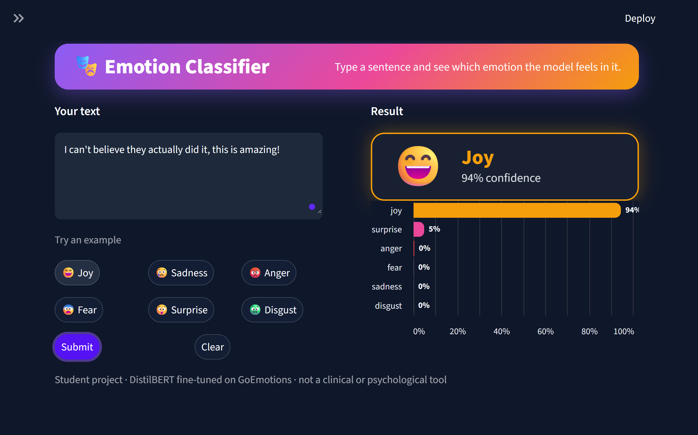
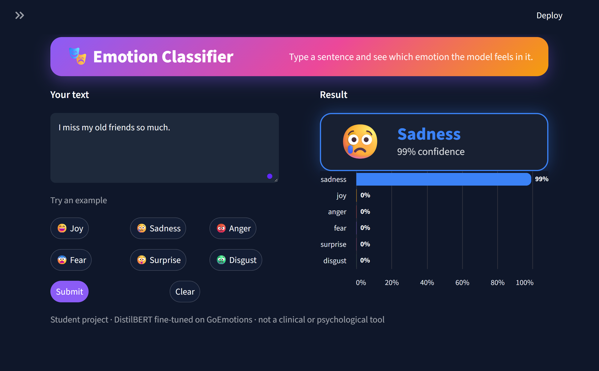
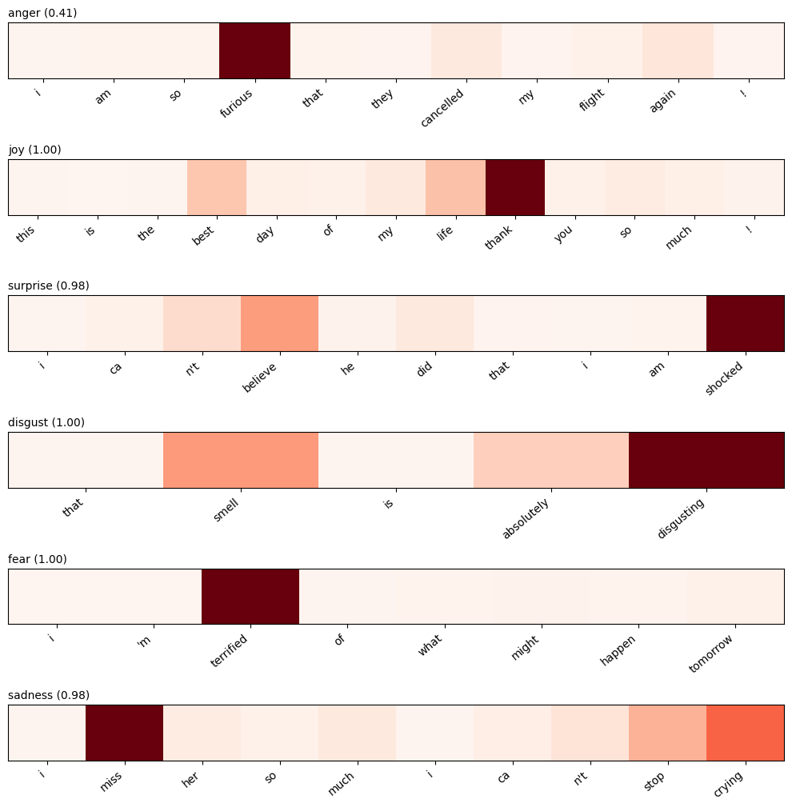
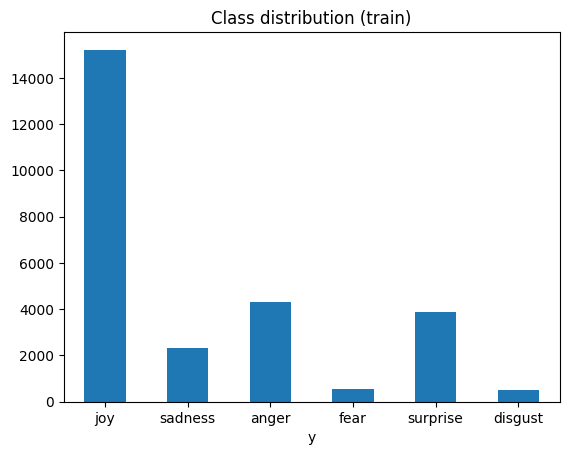
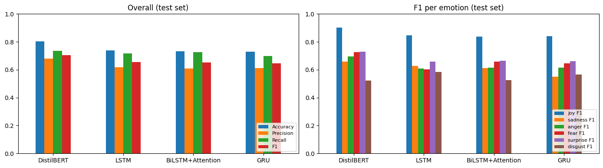
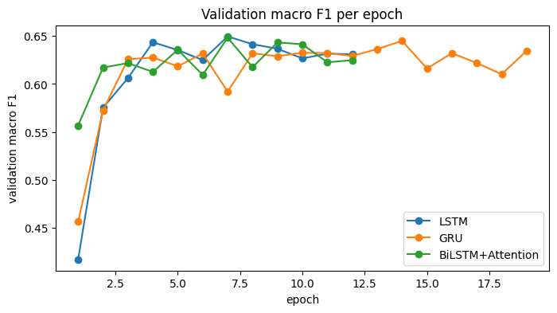
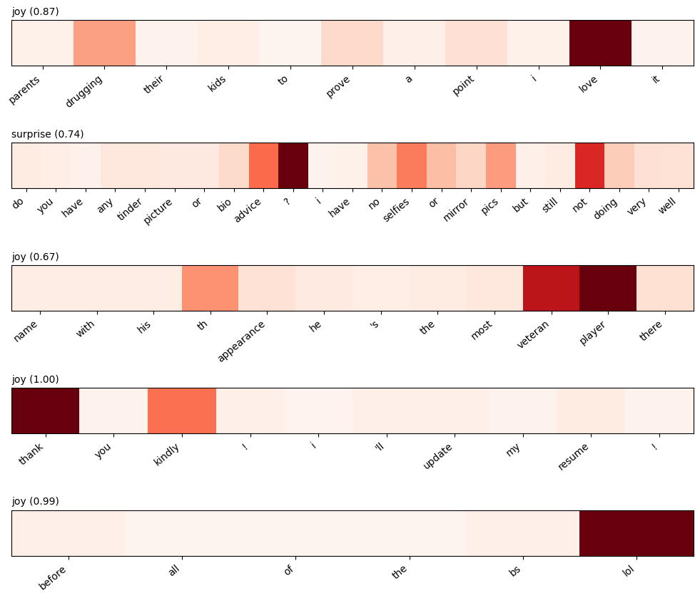
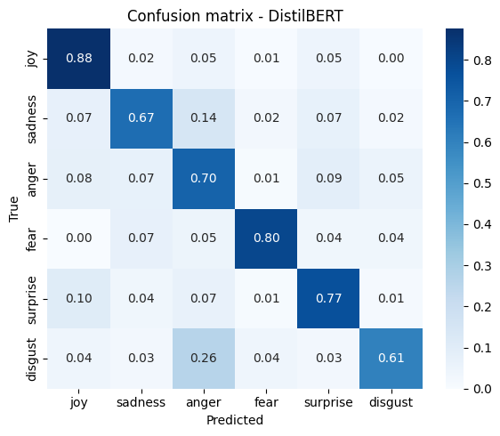

# 🎭 Emotion Classification with Attention (GoEmotions)


A text classifier that reads an English comment and predicts its emotion: **joy, sadness, anger, fear, surprise or disgust**. Four models are trained and compared on the same data: **LSTM, GRU and BiLSTM + Attention** (built from scratch in PyTorch with GloVe embeddings) and a fine-tuned **DistilBERT**. The attention model is also used to show **which words** drive each prediction. The best model (DistilBERT) is deployed as an interactive **Streamlit** app with a confidence bar chart over all six emotions.

> ⚠️ This is a student project. It is not a clinical or psychological tool.

---

## 🌐 Links

- 📓 **Training notebook on Kaggle:** [emotion-classification-with-attention](https://www.kaggle.com/code/abdelazizelshourbgy/emotion-classification-with-attention) 
- 🚀 **Live demo:** [Streamlit app](https://your-app-name.streamlit.app/) 
- 🤗 **Fine-tuned model on the Hugging Face Hub:** [Abd3laziz1/emotion-distilbert-goemotions](https://huggingface.co/Abd3laziz1/emotion-distilbert-goemotions) <!-- update this link -->

## 📸 Demo

<!-- Put your screenshots in assets/ and keep the names below -->



### Which words matter? (attention heatmaps)



---

## ✨ Features

- Predicts **6 emotions** and shows the confidence for each one in a colored bar chart
- Example sentences for every emotion, and a warning when the model is not sure
- Compares three models built from scratch and a fine-tuned transformer on exactly the same split
- **Attention heatmaps** that show the words each prediction relied on
- Class-weighted training and **macro F1** evaluation to handle the strong class imbalance
- Error analysis of the most frequent confusions

## 🗂️ Dataset

**GoEmotions** (Google Research), about 58k Reddit comments labeled with 27 emotions or `neutral`, loaded from Hugging Face ([`google-research-datasets/go_emotions`](https://huggingface.co/datasets/google-research-datasets/go_emotions), `simplified` version). The original split is **43,410 train / 5,426 validation / 5,427 test** comments.

The project needs 6 emotions, so the 27 fine-grained emotions were grouped with the standard **Ekman** mapping (for example `annoyance` → anger, `gratitude` and `love` → joy, `nervousness` → fear, `grief` → sadness, `curiosity` → surprise). About 84% of the training comments have a single label, but some have several, so a comment is **kept only if all of its labels map to one single emotion**. Neutral comments and comments that mix different emotions are dropped.

- Train: 26,732 kept of 43,410 (14,219 neutral and 2,459 mixed-emotion comments dropped)
- Final split: **26,732 train / 3,354 validation / 3,362 test**

| Emotion | Train | Validation | Test |
|---|---|---|---|
| joy | 15,216 | 1,941 | 1,863 |
| anger | 4,293 | 555 | 572 |
| surprise | 3,858 | 459 | 488 |
| sadness | 2,326 | 266 | 283 |
| fear | 541 | 72 | 80 |
| disgust | 498 | 61 | 76 |

The classes are strongly imbalanced: `joy` is about 57% of the training data, while `fear` and `disgust` are about 2% each. Training uses **class weights** (from 0.29 for joy up to 8.95 for disgust) and models are compared by **macro F1**.



## 🧪 Method

**Cleaning (RNN models):** lowercase, contractions split the way GloVe expects (`didn't` → `did n't`), names and religions placeholders turned into plain words, `!` and `?` kept. **Stop words are kept** on purpose, because words like `not` and `never` change the emotion. DistilBERT reads the original text with its own tokenizer.

| Model | Details |
|---|---|
| LSTM | Reads left to right and uses the last hidden state |
| GRU | Same, with a GRU cell |
| BiLSTM + Attention | Reads in both directions. Each word gets a score, the scores become weights (softmax) and the sentence vector is the weighted average of all hidden states |
| DistilBERT | `distilbert-base-uncased`, fine-tuned for 6-class classification |

**From-scratch models:** GloVe vectors (100d, 400,000 words, found for 99.1% of the training tokens) used as the starting point of the embedding layer and fine-tuned during training → dropout 0.5 → RNN with 128 units (per direction) → classifier. The attention layer has 128 units. Adam with learning rate 1e-3, batch 64, up to 20 epochs with early stopping on validation macro F1 (patience 5), class-weighted loss.

**DistilBERT:** 4 epochs, learning rate 3e-5, batch 32, max length 64, class-weighted loss, mixed precision, and the best epoch by validation macro F1 is kept. Training took about 2.5 minutes on a Kaggle GPU.

---

## 📊 Results

### Comparison of the four models (test set, 3,362 comments)

Precision, recall and F1 are macro averages (every emotion counts the same). **Macro F1** is the main metric.

| Model | Accuracy | Precision | Recall | Macro F1 |
|---|---|---|---|---|
| **DistilBERT** | **0.805** | **0.681** | **0.736** | **0.706** |
| LSTM | 0.739 | 0.617 | 0.717 | 0.655 |
| BiLSTM + Attention | 0.732 | 0.608 | 0.726 | 0.652 |
| GRU | 0.730 | 0.612 | 0.699 | 0.646 |

### F1 per emotion (test set)

| Model | joy | sadness | anger | fear | surprise | disgust |
|---|---|---|---|---|---|---|
| DistilBERT | **0.903** | **0.657** | **0.694** | **0.727** | **0.729** | 0.523 |
| LSTM | 0.846 | 0.629 | 0.611 | 0.604 | 0.659 | **0.583** |
| BiLSTM + Attention | 0.838 | 0.613 | 0.615 | 0.660 | 0.664 | 0.524 |
| GRU | 0.840 | 0.550 | 0.617 | 0.646 | 0.661 | 0.564 |



- **DistilBERT is clearly the best**, about 5 macro F1 points and 6.6 accuracy points above the best from-scratch model. It starts from a language model trained on a huge amount of text, which helps a lot on short, informal comments.
- **Attention did not improve the score.** BiLSTM + Attention (0.652) is level with LSTM (0.655) and GRU (0.646), and the gaps are under one point. Each model was trained once, so there is no evidence for or against attention here. In this project its value is **interpretability**, not accuracy.
- **Disgust is the hardest emotion** for every model, with only 498 training and 76 test comments. DistilBERT's disgust F1 (0.523) is even lower than the LSTM's (0.583), but with 76 test comments a handful of examples can move this number a lot.
- Macro recall is higher than macro precision for all four models, which is consistent with the class weights pushing the models to predict the small classes more often (not tested separately).
- **The from-scratch models overfit.** Their training loss kept falling while validation F1 stayed flat and noisy, and early stopping ended training after 12 (LSTM), 19 (GRU) and 12 (BiLSTM + Attention) epochs. The fine-tuned embedding layer holds about 40 million of their parameters, which probably contributes (not tested).



### What does the attention model look at?

For six hand-written sentences, the BiLSTM + Attention model gave the highest weight to the emotional word and predicted the expected emotion each time: `furious` (anger), `thank` and `best` (joy), `shocked` and `believe` (surprise), `disgusting` (disgust), `terrified` (fear), `miss` and `crying` (sadness). The anger example had a low confidence (0.41), the others were 0.98 or higher. Attention weights are a useful hint about what the model looked at, but they are **not a proof** of why it decided.



### Error analysis (DistilBERT)



Most frequent confusions on the test set (these are absolute counts, and `joy` has the most test comments):

| True | Predicted | Comments |
|---|---|---|
| joy | surprise | 89 |
| joy | anger | 86 |
| surprise | joy | 51 |
| anger | surprise | 50 |
| anger | joy | 44 |
| sadness | anger | 41 |
| anger | sadness | 40 |
| joy | sadness | 37 |

Many mistakes are on comments whose label is hard to defend even for a person, for example `You ain't wrong` (labeled joy, predicted anger) or `Your TLDR sucks` (labeled sadness, predicted anger). Emotion labels are subjective and the comments are short, so part of the remaining error comes from the data itself.

---

## 📁 Project structure

```
emotion-classification-with-attention/
├── streamlit_app.py                           # Streamlit app (loads the model from the Hub)
├── emotion-classification-with-attention.ipynb  # training, comparison and analysis notebook
├── requirements.txt
├── .streamlit/config.toml                     # app theme
├── assets/                                    # screenshots and charts
├── LICENSE
└── README.md
```

The fine-tuned model (about 260 MB) is **not stored in this repository** because of GitHub's file size limit. It is hosted on the [Hugging Face Hub](https://huggingface.co/Abd3laziz1/emotion-distilbert-goemotions) <!-- update this link --> and the app loads it from there automatically. The Kaggle notebook produces it in `/kaggle/working/emotion_model`.

## 🚀 Run locally

```bash
git clone https://github.com/AbdelazizElshourbgy-ui/emotion-classification-with-attention.git
cd emotion-classification-with-attention

python -m venv venv
venv\Scripts\activate        # Windows
# source venv/bin/activate   # macOS / Linux

pip install -r requirements.txt
streamlit run streamlit_app.py
```

Open the address printed in the terminal (usually `http://localhost:8501`). The first start downloads the model from the Hub, and the app runs on CPU.

## 🔁 Reproduce the training

Open the notebook on Kaggle, turn on a **GPU** and **Internet**, and press **Run All**. The dataset and the GloVe vectors are downloaded automatically from Hugging Face. The whole notebook takes roughly 10 minutes, and DistilBERT training takes about 2.5 minutes.

Everything uses PyTorch only, so there is no framework conflict on the GPU.

## ⚠️ Limitations

- **The model always picks one of the six emotions**, even for neutral text, because neutral and mixed-emotion comments were removed from the data.
- Each model was trained once, with no hyperparameter search, so small gaps between the from-scratch models are not reliable.
- `fear` and `disgust` have very few examples (about 500 each in training), so they are the least reliable emotions.
- The data is English Reddit comments. Sarcasm, slang and other kinds of text are hard, and emotion labels are subjective and noisy.
- Attention weights hint at what the model used but do not prove why it made a decision, and the app itself shows DistilBERT scores, not attention.
- The confidence scores are not calibrated probabilities.
- The live demo runs on a free CPU tier, so the first request after a period of inactivity can be slow.

## 🔮 Future work

- Add a `neutral` class or use the original multi-label setup with all 27 emotions
- Run several seeds to measure the variance between models
- Try larger transformers and attention visualization for the transformer
- Calibrate the confidence scores

## 🛠️ Tech stack

Python · PyTorch · HuggingFace Transformers and Datasets · scikit-learn · gensim (GloVe) · Streamlit · Altair · Pandas · Matplotlib · Seaborn · Kaggle

## 👤 Author

**Abdelaziz Elshourbgy**

GitHub: [@AbdelazizElshourbgy-ui](https://github.com/AbdelazizElshourbgy-ui) · LinkedIn: [Abdelaziz Elshourbgy](https://www.linkedin.com/in/abdelaziz-elshourbgy-b126a83a2/)

## 📄 License

Code released under the [MIT License](LICENSE). The GoEmotions dataset and the GloVe vectors belong to their original authors; see their pages for their licenses.
